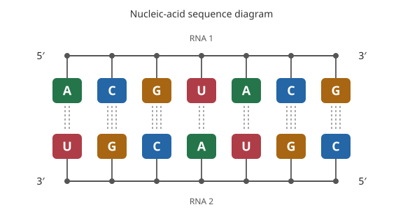

# Linear nucleic-acid sequence diagrams

[RDKit #9617](https://github.com/rdkit/rdkit/issues/9617), verified open on
2026-10-17, asks for RNA bases aligned on one side of a linear backbone and
optionally an antiparallel duplex with canonical base-pair marks.
`chematic.nucleic_acid_linear_svg` provides a **sequence diagram** for an
explicit `chematic.nucleic-acid.v1` document. It reuses the existing native
validator for residue identity, atom ownership and linear phosphodiester
linkages. It does not infer RNA from SMILES, lay out every atom or replace
`Mol.svg()`. Those parts of the upstream request remain separate.



```python
import json
from chematic import nucleic_acid_linear_svg

document = {
    "schema": "chematic.nucleic-acid.v1",
    "atom_ids": ["a5", "a3"],
    "strands": [{
        "id": "sense", "kind": "rna",
        "residues": [{"id": "a", "base": "A", "sugar": "ribose",
                      "atom_refs": ["a5", "a3"], "annotations": {}}],
        "annotations": {},
    }],
    "linkages": [],
    "annotations": {},
}
svg = nucleic_acid_linear_svg(json.dumps(document))
```

For longer strands, every adjacent residue pair must carry the document's
explicit phosphodiester linkage and matching 3′/5′ references. The existing
validator rejects missing links, ambiguous atom ownership, unknown modifications
and unsupported topology. Inputs are document metadata rather than ordinary
molecular graphs. Complete original single/duplex examples are checked in at
`validation/nucleic_linear_svg_cases.json`.

## Order and explicit pairing

By default, each strand is shown independently, left-to-right in its supplied
5′→3′ residue order. Each backbone is straight, base glyphs have fixed 64-unit
spacing, and every base faces the same side of that strand. Colored base
letters are upright; they are symbolic glyphs, not atomic structures. Labels
identify free 5′ and 3′ ends.

`antiparallel=True` requires exactly two strands. The second strand is drawn
right-to-left, retaining its original 5′→3′ order and IDs; the bases of both
strands face inward. The input document is never reversed or edited.

`base_pairs` takes a sequence of `(residue_id, residue_id)` pairs. Pairing is
never inferred from complementary-looking sequences. Each residue can occur in
only one pair, and the pair must connect distinct strands in antiparallel mode.
Unmodified A–U/A–T and C–G pairs receive two or three dashed symbolic H-bond
marks. These marks describe a caller-declared canonical pairing convention,
not measured hydrogen bonds or a prediction of secondary structure. Modified
and noncanonical pairs, including wobble pairs, raise rather than being drawn
as canonical.

All explicit pairs must occupy one ungapped antiparallel register. The first
pair establishes a horizontal offset for the second strand, and all remaining
pairs must agree. Unpaired overhangs and unequal strand lengths are supported;
bulges, gaps, crossing pairs and arbitrary secondary structures are outside
this diagram. With no `base_pairs`, antiparallel layout adds no pair marks.

Modifications are indicated by an asterisk on the base glyph, with their full
identity in a tooltip. Unknown/other base identity uses `?` plus its modification
marker; the native validator still requires a known supported modification.
No modification is silently rendered as an unmodified canonical pair.

## Source and SVG contract

The result is a self-contained SVG without scripts, external images, imported
styles or links. Caller content is serialized through an XML
serializer. The full original decoded JSON is embedded as text in
`metadata#nucleic-source`, with the input schema in `data-format`. XML character
references preserve carriage returns through XML's line-ending normalization,
so reading that node's text recovers the original JSON including LF/CRLF/CR.
The pair options are separately recorded in `metadata#nucleic-pairs` with each
pair normalized to first-strand/second-strand order.

Each strand group carries `data-strand-id`, kind and direction. Residue groups
carry `data-residue-id`, their original one-based position and JSON-encoded atom
references. Backbone segments carry original `data-linkage-id` values. Atom
references and annotations are retained as source metadata; atoms are not drawn
or assigned invented coordinates. Root title/description nodes provide an
accessible sequence-diagram description.

Inputs accept UTF-8 `str` or immutable `bytes`, up to 1 MiB. Duplicate JSON keys,
invalid encoding/schema/topology and wrong option/pair types raise. XML-invalid
characters in embedded literal source text or rendered IDs also raise; JSON
escaping can retain such annotation values without an XML-invalid literal. The renderer allows at most eight strands and
512 residues in total, after applying native document limits. Long diagrams
stay linear and may require horizontal scrolling/zoom; no line wrapping is
inferred. No SVG is returned on any validation or layout error.

## Validation

The 2026-10-17 run passed 218 selected tests: 52 new SVG cases, four existing
nucleic-document cases and 162 compatibility regressions. The cases cover
source/ID preservation, XML escaping, line endings, modifications, explicit
pairing, positive/negative overhang offsets and rejected unsupported inputs.

`validation/validate_nucleic_linear_svg.py` checks all canonical RNA and DNA
sequences of length 1..4, independently authoring their document topology and
explicit reverse-complement pairs. Across 1,360 diagrams it checked 7,512
residues and 2,504 pairs: straight backbones, fixed spacing, uniform base side,
correct strand direction, pair mark counts, in-bounds non-overlapping glyph
boxes and exact original JSON recovery. This is diagram-geometry validation,
not an RDKit atomic-coordinate comparison or an aesthetic score.

The single- and double-strand SVG examples were rendered with CairoSVG 2.9.1
and visually inspected. This host needed
`DYLD_FALLBACK_LIBRARY_PATH=/opt/homebrew/lib` to locate its existing Cairo
library. The renderer is a validation tool only; the API itself uses Python's
standard library and existing native validation. PNG/SVG examples and hashes
are recorded in `validation/results/nucleic-linear-svg-2026-10-17/`.

The existing extension was reused as an import/native-validator fixture, whose
nucleic source files match the candidate. No fresh native build, wheel release,
full-atom RNA layout, base-pair prediction or universal depiction-quality claim
is made by these results.
